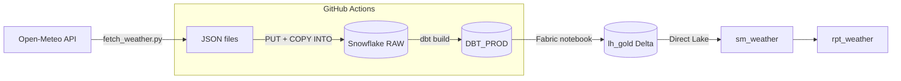
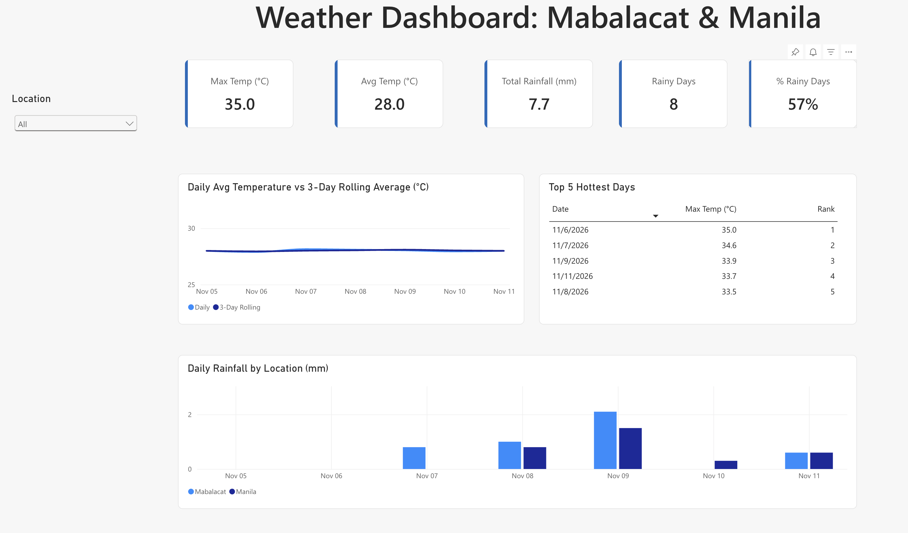
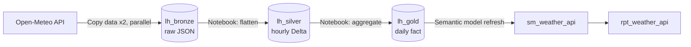
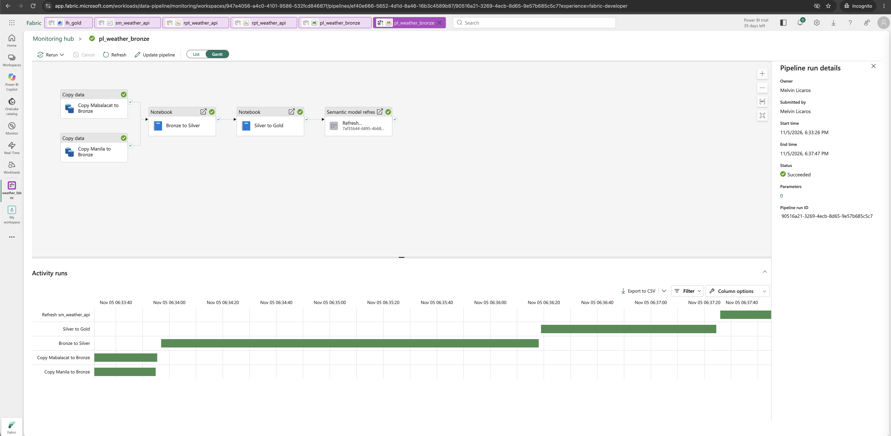
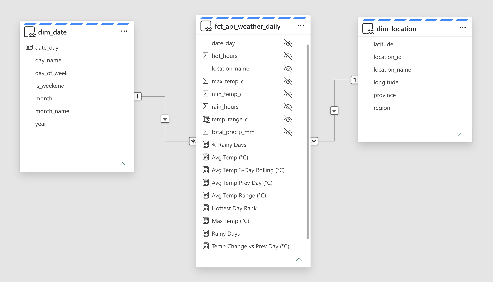

# Weather Data Pipeline: API → Snowflake → dbt → Fabric / Power BI

An end-to-end data pipeline that ingests hourly weather data for two Philippine cities (Mabalacat and Manila), loads it into Snowflake, transforms it with dbt, and serves it in a Power BI report on Microsoft Fabric. Ingestion and transformation run daily on GitHub Actions, and every pull request is tested by CI before it reaches production.


## Architecture



## Tech Stack

| Layer | Tools |
|---|---|
| Ingestion | Python, Open-Meteo API |
| Warehouse | Snowflake (stages, COPY INTO, VARIANT, FLATTEN) |
| Transformation | dbt (staging, marts, incremental model, SCD2 snapshot, 27 tests) |
| Orchestration and CI/CD | GitHub Actions (daily schedule, PR checks) |
| Serving | Microsoft Fabric (Lakehouse, PySpark notebook, Direct Lake semantic model) |
| Reporting | Power BI (DAX measures) |

## How It Works

1. **Ingest:** `fetch_weather.py` pulls hourly weather data from the Open-Meteo API and saves raw JSON.
2. **Load:** `load_weather.py` uploads the files to a Snowflake stage and runs `COPY INTO` a `VARIANT` column in `RAW.WEATHER_RAW`.
3. **Transform:** dbt flattens the JSON in staging, then builds a star schema:
   - `dim_location`, `dim_date`
   - `fct_weather_hourly`, `fct_weather_daily`
   - `weather_hourly_history` (incremental, appends only new loads)
   - `locations_snapshot` (SCD Type 2, tracks changes to location attributes)
4. **Test:** 27 dbt tests (not_null, unique, relationships, accepted_values, and custom singular tests).
5. **Serve:** A Fabric notebook copies the marts into a Lakehouse as Delta tables. A Direct Lake semantic model powers the Power BI report.

## CI/CD

| Workflow | Trigger | What it does | Target |
|---|---|---|---|
| `pipeline.yml` | Daily cron + manual | fetch → load → `dbt build` | `DBT_PROD` |
| `ci.yml` | Pull request to `main` | `dbt build` + all tests | `DBT_CI` (sandbox) |

Broken models are caught in `DBT_CI` before they can reach production.


## Security

- **Least privilege:** a dedicated `PIPELINE_USER` (Snowflake `TYPE = SERVICE`) with `PIPELINE_ROLE`, which can only load to RAW and build in `DBT_PROD` / `DBT_CI`. Fabric reads with a separate read-only `FABRIC_USER`.
- **Key-pair authentication:** no passwords for service users.
- **No secrets in the repo:** credentials live in GitHub Secrets and are passed as environment variables. `profiles.yml` only contains `env_var()` references.


## Lessons Learned

Real issues I hit and fixed while building this:

- **Invalid cron YAML failed silently.** A missing `-` and unspaced `***` made GitHub unable to parse the workflow, so the schedule never fired. Now I check the Actions tab after every push.
- **GitHub cron is best-effort.** My first scheduled run started about 3 hours late. Fine for daily weather data, but SLA-bound pipelines need a real orchestrator (Airflow, Fabric Data Pipeline).
- **Custom roles must roll up to SYSADMIN.** Tables owned by `PIPELINE_ROLE` were invisible even to `ACCOUNTADMIN` until the role was granted to `SYSADMIN`.
- **`USAGE` on the schema comes before `SELECT` on tables,** and you need both `ALL` (existing objects) and `FUTURE` (objects dbt recreates every run) grants.
- **Relative paths in CI.** Scripts must be referenced from the repo root, and the key path uses `${{ github.workspace }}` because dbt runs inside a subfolder.
- **Grain matters.** The history model's uniqueness test failed until `loaded_at` was added to the grain, because the same file can be reloaded.


## Project 2: Fabric Medallion Pipeline

A second pipeline built entirely inside Microsoft Fabric, with no Snowflake dependency. A Fabric Data Pipeline ingests the same Open-Meteo API, moves the data through Bronze, Silver and Gold lakehouses, and refreshes a Direct Lake semantic model so the Power BI report is always current.



### Architecture





### How It Works

1. **Bronze:** two Copy data activities (HTTP source, Binary format) land the raw API JSON for Mabalacat and Manila in parallel, exactly as received.
2. **Silver:** a PySpark notebook runs only after both copies succeed. It flattens the nested hourly arrays with `posexplode`, casts types, derives `location_name` from the file name, and adds a `loaded_at` timestamp. Writes are idempotent (`overwrite`).
3. **Gold:** a second notebook aggregates hourly data into a daily fact table (avg, max, min temperature, rainfall, rain hours, hot hours), rounding aggregates to remove floating point artifacts.
4. **Serve:** the pipeline refreshes the Direct Lake semantic model on success, so the report never shows partial data.

### Semantic Model



- Star schema: one daily fact table with conformed `dim_date` and `dim_location` dimensions, many-to-one, single direction
- `dim_date` marked as the date table
- Raw fact columns hidden; report builders only see explicit measures
- 11 DAX measures, including:
  - `% Rainy Days` with `DIVIDE` and `VAR ... RETURN`
  - `Avg Temp Range` built on a calculated column
  - `Avg Temp Prev Day` and `Temp Change vs Prev Day` with `DATEADD`
  - `Avg Temp 3-Day Rolling` with `DATESINPERIOD`
  - `Hottest Day Rank` with `RANKX(ALL(...))`

### Fabric Lessons Learned

- **A stray character broke the API call.** A copied URL picked up extra text, so the source returned HTTP 400. Reading the error code pointed straight to the request, not the connection.
- **Delta protects its schema.** Adding `loaded_at` failed with a schema mismatch until I used `overwriteSchema`, which fits a full overwrite better than `mergeSchema`.
- **Small capacities can queue jobs.** A notebook sat "in progress" for 9 minutes because my interactive session held the F2 Spark resources. Stopping the session freed it immediately.
- **Don't trust auto-detected relationships.** Fabric guessed cardinality from row counts and reversed the date relationship twice. The "one" side is wherever the key is unique, which is the dimension.
- **Hide raw columns once measures exist.** A card dragged from a raw column used an implicit SUM and showed 222.9°C. Hiding the columns makes that mistake impossible.
- **BLANK acts like zero in DAX arithmetic.** Day-over-day change showed a fake -26.9°C drop on a date with no data, so both sides of the comparison need an `ISBLANK` guard.
- **`RANKX` needs `ALL`.** With `VALUES`, each row only sees itself, so every day ranked first.


## Repository Structure

```
.github/workflows/   pipeline.yml (CD), ci.yml (CI)
week01-python/       fetch_weather.py
week02-snowflake/    setup SQL, roles, service user, load_weather.py
weather_dbt/         dbt project (models, tests, snapshots, ci_profiles)
docs/images/         screenshots
```

## Next Steps

- ~~Automate the Fabric layer with a Fabric Data Pipeline~~ Done, see Project 2
- Add `cache: pip` to cut install time in GitHub Actions
- Add an `is_forecast` flag, since the API mixes forecast with observed data

## Author

**Melvin Licaros**: [LinkedIn](https://www.linkedin.com/in/melvin-licaros-1a0653109) · [Portfolio](https://melvinlicaros.github.io)